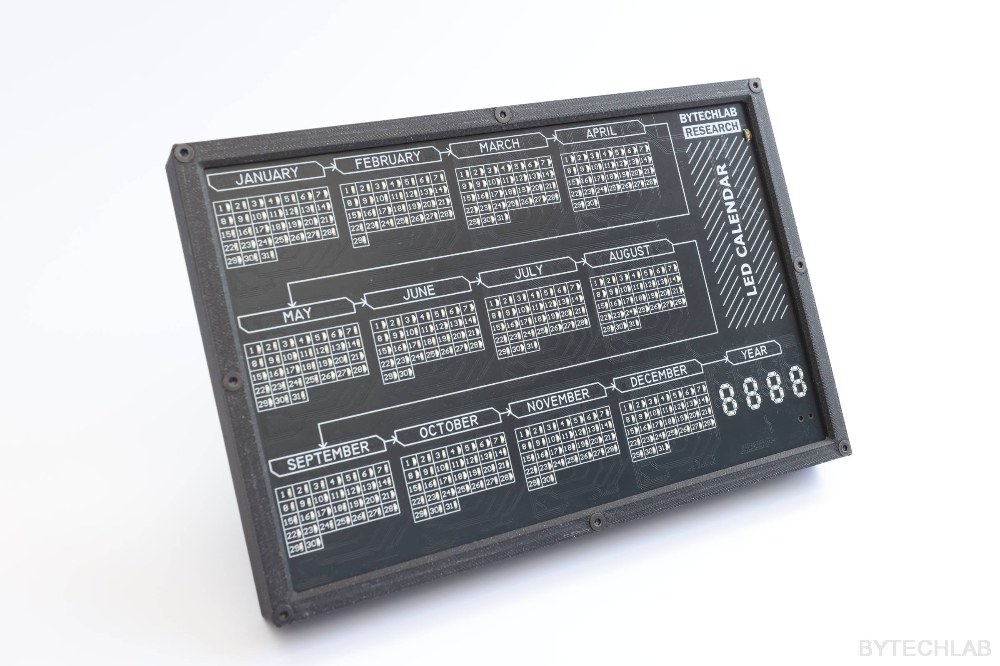

<div align="center">
    
</div>

ESP8266 based LED calendar.

### Read more at BYTECHLAB:

<table style="width: 100%; border: none;" cellspacing="0" cellpadding="0" border="0">
  <tr>
    <td></td>
    <td>https://bytechlab.com/2024/10/led-calendar-esp8266-based/</td>
  </tr>
</table>

---

## Contents

1. [How it works](#how-it-works)
2. [Time synchronisation](#time-synchronisation)
3. [Function reference](#function-reference)
4. [Configuration](#configuration)
5. [IDE setup (Arduino IDE + ESP8266 core)](#ide-setup-arduino-ide--esp8266-core)
6. [Uploading to an ESP-12E module](#uploading-to-an-esp-12e-module)
7. [Serial monitor output](#serial-monitor-output)
8. [Troubleshooting](#troubleshooting)

---

## How it works

### Hardware interface

All LEDs are driven by a chain of shift registers with a storage (latch) register and an output-enable input. The firmware bit-bangs the chain at about 20 kHz.

| Signal | GPIO | Purpose |
|---|---|---|
| `PIN_LED_SCK` | 14 | Shift clock |
| `PIN_LED_SDOUT` | 13 | Serial data |
| `PIN_LED_OE` | 12 | Output enable (active low). Driven with 20 kHz PWM for brightness. |
| `PIN_LED_STORE_DAT` | 5 | Storage register clock (latch). A rising edge copies the shifted data to the outputs. |
| `PIN_LED_MASTER_RST` | 4 | Master reset. Held HIGH, so it is inactive. |
| `A0` | ADC | Ambient light sensor |

### LED frame layout (416 bits)

Every display update shifts a full frame into the chain and then latches it:

```
[ year digit 0..3: 4 × 8 bits ][ day LEDs: 384 bits ]
   ones, tens, hundreds,         12 months × 32 slots
   thousands (LSB first)
```

- **Year:** each decimal digit is converted to a 7-segment pattern using `LED_Calendar_Year_Digit_LUT`. Each digit is 8 bits; the LSB is unused, as the decimal point.
- **Days:** every month has 32 slots, so the index of the current day is:

  ```
  day_led = (month - 1) * 32 + day
  ```

  The firmware shifts `384 - day_led` zeros followed by `day_led` ones. All days from 1 January up to today are lit.

### Main loop (one pass takes about 2 s)

```
loop():
  NTP_Handle_Sync()               → syncs over WiFi only when due, otherwise returns at once
  NTP_Update_Time_Variables()     → reads the date from the local clock (no network)
  LED_Calendar_Check_Ambient_Light()
  if date changed → LED_Calendar_Write_Date_To_LEDs_Animation()
  wait 1 s → today's LED on
  wait 1 s → today's LED off      (this is the 1 Hz blink)
```

The date is re-read on every pass, so a new day appears within about 2 seconds after 00:00 local time.

### Brightness

`analogRead(A0)` (0…600) is mapped to a PWM duty on `OE` from 254 (darkest) to 230 (brightest). Because `OE` is active low, a higher PWM value gives dimmer LEDs. `map()` does not clamp its output, so readings above 600 make the display slightly brighter than 230.

---

## Time synchronisation

The firmware uses the ESP8266 Arduino core's built-in SNTP client and the POSIX timezone support, not an external NTP library.

- **Timezone and DST:** set with a POSIX TZ string. The default `CET-1CEST,M3.5.0,M10.5.0/3` is Central European Time. Daylight saving changes on the last Sunday of March and October are applied automatically.
- **Local clock:** after a successful sync, `time()` keeps counting from the ESP8266 system timer. A typical crystal error of ±20–50 ppm is about 2–5 s per day.
- **WiFi off between syncs:** the radio sleeps (`WIFI_OFF` + `forceSleepBegin`) except during a sync, which takes a few seconds.

### When a sync happens

| Trigger | Condition | Retry on failure |
|---|---|---|
| Boot | Always. Blocks until a valid time is received, so a 1970 date is never shown. | every 10 s |
| Pre-midnight | Local time 23:50 – 23:58, if the last successful sync was more than 1 h ago | every 2 min while inside the window |
| Fallback | No successful sync for more than 25 h | every 15 min |

Normal operation is **one NTP request per day**, made a few minutes before midnight. Clock drift at the day rollover is therefore well under a second.

### One sync, step by step (`NTP_Sync_Once`)

1. Wake the radio, then connect to WiFi (20 s timeout).
2. Call `configTime(TZ, server)`. This restarts SNTP, which sends a request immediately because the startup delay is set to 0.
3. Wait up to 10 s for `NTP_Time_Set_Callback(from_sntp = true)`.
4. Call `sntp_stop()`. The system clock keeps running locally.
5. Disconnect and put the radio back to sleep.

---

## Function reference

### Arduino entry points

| Function | Description |
|---|---|
| `setup()` | Starts serial at 115200 baud and turns WiFi off with flash persistence disabled. It then initialises the LED pins and PWM, sets the brightness, runs the startup animation, does the first NTP sync (blocking), and reads the date. |
| `loop()` | Handles sync scheduling, the date check, brightness, a redraw when the date changes, and the 1 Hz blink of the current day's LED. |

### Time / network

| Function | Description |
|---|---|
| `NTP_Setup()` | Registers the SNTP callback, sets the `TZ` environment variable, and retries `NTP_Sync_Once()` every 10 s until it succeeds. |
| `NTP_Handle_Sync()` | Decides whether a sync is due (pre-midnight window, fallback interval, retry back-off) and calls `NTP_Sync_Once()` if so. Cheap when nothing is due. |
| `NTP_Sync_Once()` | Runs one complete sync: WiFi on → SNTP request → wait → SNTP stop → WiFi off. Returns `true` on success and updates the sync and retry bookkeeping. |
| `NTP_Time_Set_Callback(bool from_sntp)` | Called by the core whenever the system time is set. Sets `NTP_Sync_Received` when the time came from SNTP. |
| `NTP_Update_Time_Variables()` | Reads the local time (`time()` + `localtime_r()`) into `LED_Calendar_Day`, `_Month` and `_Year`. No network access. |
| `NTP_Print_Local_Time()` | Prints `YYYY-MM-DD HH:MM:SS CET/CEST` to serial. |
| `WiFi_Wake_And_Connect()` | Wakes the radio, switches to station mode and connects, with a timeout. Returns `true` when connected. |
| `WiFi_Sleep()` | Disconnects, sets `WIFI_OFF` and puts the radio into forced sleep. |
| `sntp_update_delay_MS_rfc_not_less_than_15000()` | Core hook. Sets the background SNTP interval to 24 h. Normally unused, because SNTP is stopped after every sync. |
| `sntp_startup_delay_MS_rfc_not_less_than_60000()` | Core hook. Returns 0 so the first SNTP request goes out immediately, which keeps the radio on for less time. |

### LED calendar

| Function | Description |
|---|---|
| `LED_Calendar_Setup()` | Configures the GPIOs and holds master reset inactive. Sets the PWM to 20 kHz and starts at the lowest brightness. |
| `LED_Calendar_Check_Ambient_Light()` | Reads `A0`, maps it to the `OE` PWM duty, and prints the reading. |
| `LED_Calendar_Startup_Animation()` | Fills all 416 outputs one by one (a power-on test). |
| `LED_Calendar_Clear_All_Leds()` | Shifts 416 zeros and latches them, turning everything off. |
| `LED_Calendar_Write_Date_To_LEDs_Animation()` | Shows the year and animates the day LEDs filling up to today. Called when the date changes. |
| `LED_Calendar_Write_Date_Blink_Last_LED(unsigned int last_led_onoff)` | Redraws the year and days, with today's LED off (`1`) or on (`0`). Called once per second for the blink. |

---

## Configuration

Edit these at the top of `3_CALENDAR_CODE_V2.ino`:

| Setting | Default | Notes |
|---|---|---|
| `ssid`, `password` | — | Your WiFi credentials (2.4 GHz only) |
| `NTP_TZ` | `"CET-1CEST,M3.5.0,M10.5.0/3"` | POSIX TZ string. Examples: UK `GMT0BST,M3.5.0/1,M10.5.0`, US East `EST5EDT,M3.2.0,M11.1.0` |
| `NTP_SERVER` | `"pool.ntp.org"` | A regional pool such as `pl.pool.ntp.org` is also fine |
| `NTP_PRE_MIDNIGHT_WINDOW_START_MIN` / `_END_MIN` | 50 / 59 | Daily sync window in minutes after 23:00 |
| `NTP_FALLBACK_INTERVAL_MS` | 25 h | Forces a sync if the daily one was missed |
| `NTP_RETRY_WINDOW_MS` / `NTP_RETRY_OTHER_MS` | 2 min / 15 min | Retry back-off |
| `WIFI_CONNECT_TIMEOUT_MS` / `NTP_RESPONSE_TIMEOUT_MS` | 20 s / 10 s | Longest time the radio stays on per attempt |
| `LED_CALENDAR_MAX_BRIGHTNESS` / `_MIN_BRIGHTNESS` | 230 / 254 | PWM duty limits for `OE` (lower value = brighter) |

---

## IDE setup (Arduino IDE + ESP8266 core)

### 1. Install Arduino IDE

Download Arduino IDE 2.x from <https://www.arduino.cc/en/software>. Version 1.8.19 also works.

### 2. Add the ESP8266 board package URL

**File → Preferences → Additional boards manager URLs**, then add:

```
https://arduino.esp8266.com/stable/package_esp8266com_index.json
```

### 3. Install the ESP8266 core

**Tools → Board → Boards Manager**, search for **esp8266**, and install **"esp8266 by ESP8266 Community"**, version **3.0.0 or newer** (the latest 3.x is recommended).

> Version 3.x is required for `settimeofday_cb(bool)` and the SNTP delay hooks. With 2.x the sketch will not compile.

### 4. Libraries

**No extra libraries are needed.** Everything used (`ESP8266WiFi`, `time.h`, `coredecls.h`, `sntp.h`) is part of the ESP8266 core.

If you have **NTPClient** installed from the earlier version of this project, you can remove it. The sketch no longer uses it.

### 5. Open the sketch

Arduino requires the `.ino` file to be inside a folder with the same name:

```
3_CALENDAR_CODE_V2/
└── 3_CALENDAR_CODE_V2.ino
```

### 6. Board settings for ESP-12E

Under **Tools**:

| Option | Bare ESP-12E module / custom PCB | NodeMCU-type dev board |
|---|---|---|
| Board | **Generic ESP8266 Module** | **NodeMCU 1.0 (ESP-12E Module)** |
| Flash Size | 4MB (FS:2MB OTA:~1019KB) or any 4MB option | 4MB (FS:2MB OTA:~1019KB) |
| Flash Mode | DIO (QIO usually works too) | DIO |
| Crystal Frequency | 26 MHz | 26 MHz |
| CPU Frequency | 80 MHz | 80 MHz |
| Upload Speed | 115200 (try 460800/921600 if stable) | 115200 – 921600 |
| Reset Method | "dtr (aka nodemcu)" with an auto-reset circuit, otherwise "no dtr (aka ck)" | dtr (aka nodemcu) |
| Erase Flash | Only Sketch | Only Sketch |
| Port | The COM / ttyUSB port of your USB-UART adapter | The board's port |

80 MHz CPU is enough and draws less current than 160 MHz.

---

## Uploading to an ESP-12E module

The LED Calendar PCB has its own USB programming interface. No external USB-UART adapter or jumper wires are needed.

### Programming circuit on the PCB

| Part | Function |
|---|---|
| **J1** – Micro-USB (47346-0001) | Connection to the PC |
| **U1** – CP2102N (QFN28) | USB ↔ UART bridge. TXD/RXD go to the ESP's RXD0/TXD0, and DTR/RTS drive the auto-programming circuit. Powered from the board's +3.3 V rail (VDD = VREGIN). |
| **Q1, Q2** – S8050 + R6/R13 (12 kΩ) | Cross-coupled auto-programming circuit (NodeMCU style). DTR/RTS control `nRST` and `GPIO0`. |
| **S1** – KEY_RST/USER | Pulls `nRST` to GND through R8 (470 Ω), which resets the ESP |
| **S2** – KEY_FLASH | Pulls `GPIO0` to GND through R10 (470 Ω), which selects flash mode on reset |
| R4, R5, R9, R11 (12 kΩ) | Pull-ups on GPIO0, GPIO2, EN and nRST, to +3.3 V |
| R12 (12 kΩ) | Pull-down on GPIO15 |
| C4 (100 nF) | Reset delay / filter on `nRST` |
| R7 (NC) | Optional GPIO16 → nRST link, needed only for deep-sleep wake-up. **Leave it unfitted.** This firmware uses WiFi modem sleep, not deep sleep. |

Auto-programming truth table:

| DTR | RTS | RST | GPIO0 | Result |
|---|---|---|---|---|
| 1 | 1 | 1 | 1 | Run (idle) |
| 0 | 0 | 1 | 1 | Run (idle) |
| 1 | 0 | 0 | 1 | Reset |
| 0 | 1 | 1 | 0 | GPIO0 low, so the ESP enters flash mode when released from reset |

Boot strapping on every reset: GPIO15 = LOW, GPIO2 = HIGH, and GPIO0 HIGH → run mode / LOW → flash mode. The pull resistors above handle this.

### USB driver

- **Windows 10/11:** the CP210x driver usually installs automatically. If no COM port appears, install the *CP210x Universal Windows Driver* from Silicon Labs (<https://www.silabs.com/developer-tools/usb-to-uart-bridge-vcp-drivers>).
- **Linux:** the `cp210x` driver is built in, and the port shows up as `/dev/ttyUSB0`. Add your user to the `dialout` group (`sudo usermod -aG dialout $USER`, then log out and back in).
- **macOS:** the driver is built in. The port appears as `/dev/cu.usbserial-…` or `/dev/cu.SLAB_USBtoUART`.

### IDE settings for this PCB

Use the board settings from [IDE setup](#6-board-settings-for-esp-12e) with:

- **Board:** NodeMCU 1.0 (ESP-12E Module), or Generic ESP8266 Module
- **Reset Method:** `dtr (aka nodemcu)`. The auto-programming circuit needs this.
- **Upload Speed:** 921600 normally works through the CP2102N. Drop to 115200 if uploads fail.
- **Port:** the CP2102N COM / ttyUSB port

### Uploading – automatic (normal case)

1. Make sure the board's 3.3 V rail is powered, because the CP2102N runs from it.
2. Connect J1 to the PC with a micro-USB **data** cable. Charge-only cables don't work.
3. Select the port and click **Upload**.
4. esptool pulses DTR/RTS, the ESP enters flash mode, and the sketch is written. After `Hard resetting via RTS pin...` the calendar restarts and runs the new firmware.

No buttons are needed.

### Uploading – manual override with the buttons

Use the buttons if the automatic upload fails, for example `Failed to connect to ESP8266: Timed out waiting for packet header`, or if a terminal program is holding DTR/RTS.

1. Press and hold **S2 (KEY_FLASH)**.
2. Press and release **S1 (KEY_RST/USER)** while still holding S2.
3. Release **S2**. The ESP is now in the ROM bootloader. The LEDs stay dark and the startup animation does not run.
4. Click **Upload** in the IDE.
5. When the upload finishes, press **S1 (KEY_RST/USER)** once to start the firmware, if it didn't restart on its own.

You can also do steps 1–3 while the IDE prints `Connecting........_____`.

### Serial monitor and DTR/RTS

The Arduino IDE serial monitor handles DTR/RTS correctly. If another terminal program holds the board in reset or in flash mode (no output, or only bootloader text), disable DTR and RTS flow control in that program, or press **S1** with the monitor open.

### ADC note

The ESP-12E `A0` pin accepts only **0 – 1.0 V**. On this PCB the light-sensor signal (`ADC`) goes through an R2 (220 kΩ) / R1 (100 kΩ) divider, which brings 3.3 V down to about 1.03 V.

---

## Serial monitor output

Set the monitor to **115200 baud**. A normal start looks like this:

```
<--------- LED CALENDAR STARTUP --------->
Ambient Light Intensity = 312
Connecting to MyWiFi
........ connected
NTP sync OK, local time: 2026-10-31 20:15:42 CET
Ambient Light Intensity = 310
New date received --> Updating LEDs, local time: 2026-10-31 20:15:43 CET
Ambient Light Intensity = 309
...
```

Every night between 23:50 and 23:58 you should see one more `Connecting… / NTP sync OK` block, then `New date received` at about 00:00:0x.

---

## Troubleshooting

| Symptom | Cause / fix |
|---|---|
| Compile error about `settimeofday_cb` or `sntp_update_delay_MS…` | ESP8266 core older than 3.0. Update it in Boards Manager. |
| `Retrying first NTP sync in 10 s` repeats forever | Wrong SSID or password, a 5 GHz-only network, or UDP port 123 blocked. Check the credentials and try another `NTP_SERVER`. |
| Day changes at 01:00 or 23:00 | Wrong `NTP_TZ` string for your location. |
| `A fatal esptool.py error occurred: Failed to connect` | Wrong port, Reset Method not `dtr (aka nodemcu)`, a charge-only USB cable, or a weak 3.3 V supply. Use the manual S2 + S1 button sequence. |
| Random resets while WiFi is connecting | Supply cannot handle the current peaks of about 300 mA. Add 100–470 µF near VCC. |
| Garbage on the serial monitor right after reset | Normal. The ROM bootloader prints at 74880 baud. |


